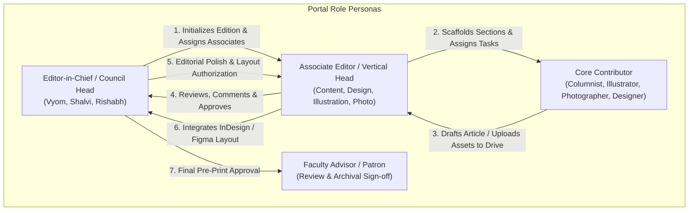
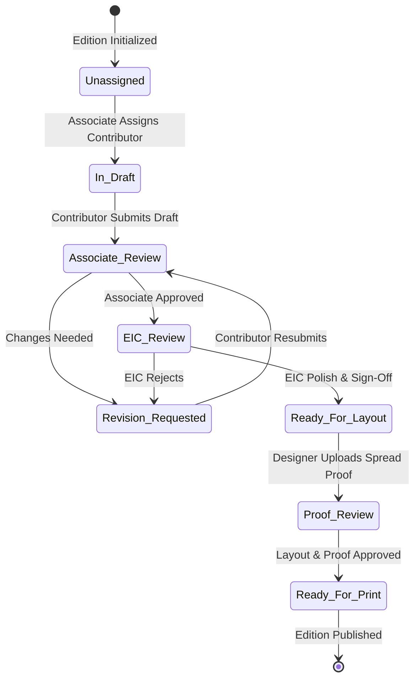
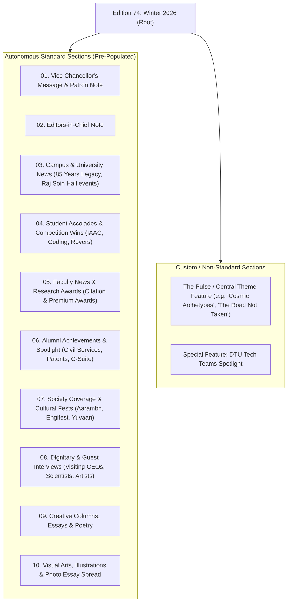
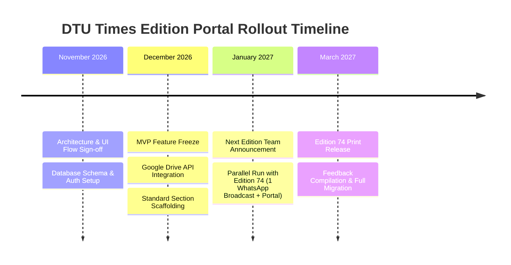

# DTU Times Edition Portal — User Flow & Architecture Blueprint

**Prepared for:** Vyom Raturi (Senior / Council Head) & DTU Times Editorial Board  
**Author:** Shubhi Dixit  
**Date:** October 20, 2026  
**Edition Target:** MVP rollout for December 2026 / January 2027 (Parallel run with Edition 74)

---

## 1. Executive Summary & Core Objectives

### The Operational Challenge
Every quarterly edition of **DTU Times** (60–80+ page publication) represents months of cross-functional collaboration involving 70–90+ student members across multiple verticals:
* **Columnists & Content Writers** (Campus News, Faculty/Student Accolades, Interviews, Creative Writing)
* **Photographers & Media Curators** (High-res event archives, campus shots, dignitary captures)
* **Illustrators & Digital Artists** (Thematic conceptual art, custom spot illustrations, cover art)
* **Designers & Layout Artists** (Adobe InDesign / Figma grid layout, typography, print formatting)
* **Associate Editors & Department Heads** (Reviewers, project managers, quality controllers)
* **Editors-in-Chief (EICs) & Faculty Advisors** (Final editorial sign-off, university administration liaison)

Currently, this complex workflow is coordinated across **20 to 25 distinct WhatsApp groups** per edition. This causes severe operational friction:
1. **Information Fragmentation:** Critical files, feedback comments, and copy revisions are lost across endless chat threads.
2. **Associate Burnout:** 9 associate editors must manually track scores of individual chats, chasing submissions and cross-posting between writers and designers.
3. **Asset Chaos & Version Confusion:** WhatsApp compresses high-resolution photographs and vector illustrations; designers struggle to know which copy edit is the final sign-off.
4. **Unverifiable Annual Performance Appraisals:** End-of-year retention and leadership promotions historically rely on unverified Google Forms and subjective recall rather than verified contribution logs.

### The Solution: The DTU Times Edition Portal
A unified, role-based web application tailored specifically to DTU Times' editorial cadence, featuring:
* **MS Teams / Slack-inspired Workspace:** Dual-column navigation with persistent edition context, standard section channels, and focused editorial workspaces.
* **Autonomous Edition Scaffolding:** Instant pre-population of standard recurring sections and automated Google Drive folder provisioning.
* **5-Stage Multi-Vertical Review Pipeline:** Clear handoffs from Columnist Draft &rarr; Associate Review &rarr; EIC Polish &rarr; Visual Pairing & Layout &rarr; Print-Ready Sign-off.
* **Society Activity & Performance Tracker:** Concrete tracking of every submission, revision turnaround, and published contribution for objective year-end reviews.

---

## 2. Multi-Persona User Journeys

The portal accommodates four key stakeholder roles with tailored permissions and distinct user journeys.



### 2.1 Persona 1: Editor-in-Chief / Council Head
* **Goal:** High-level project oversight, edition milestone tracking, associate management, and final editorial integrity.
* **Step-by-Step Flow:**
  1. **Login & Dashboard:** Signs in with DTU Times credentials; lands on the Executive Edition Overview showing overall progress (e.g., 68% completed, 42/50 pages drafted, 8 in layout).
  2. **Edition Initialization:** Clicks `+ New Edition` (e.g., "Edition 74 — Winter 2026"). Enters theme, target release date, and target page count.
  3. **Auto-Scaffolding:** System automatically creates standard sections and provisions Google Drive folders.
  4. **Associate Delegation:** Designates Lead Associates for each vertical (Content, Design, Illustration, Media).
  5. **Stage Gates & Approvals:** Receives notifications when sections pass Associate Review. Performs final editorial polish, flags sensitive items, and approves content for the Design phase.
  6. **Appraisal Review:** Accesses the Annual Performance Tracker to review verified contribution heatmaps and objective metrics before promotions.

### 2.2 Persona 2: Associate Editor (Content & Vertical Leads)
* **Goal:** Direct management of assigned sections, columnist task delegation, iterative copy-editing, and cross-vertical asset matching.
* **Step-by-Step Flow:**
  1. **Section Queue:** Views assigned sections in the sidebar (e.g., *Campus News*, *Alumni Spotlight*, *Dignitary Interviews*).
  2. **Task Assignment:** Assigns 2nd- and 3rd-year columnists with target word counts, research angles, and submission deadlines.
  3. **Visual Asset Tagging:** Flags required visuals (e.g., "Need 1 horizontal high-res photo of Raj Soin Hall + 1 vector mascot illustration").
  4. **Iterative Copy-Editing:** Opens draft in the built-in split-screen editor; leaves inline comments, requests revisions, or directly polishes text.
  5. **Status Elevation:** Once satisfied, changes state to `Associate Approved`, triggering notification to the EIC.
  6. **Asset Linking:** Pairs approved copy with submitted photographs and illustrations from the Media and Illustration pools, handing over the package to the Design team.

### 2.3 Persona 3: Core Contributor (Columnist, Illustrator, Photographer)
* **Goal:** Knowing assigned assignments, writing without distraction, uploading high-res raw assets safely, and seeing personal contribution credit.
* **Step-by-Step Flow:**
  1. **Personal Dashboard:** Logs in to see "My Assignments" with clear countdown timers (e.g., *Orientation Recap: Due Oct 24*).
  2. **Drafting Workspace:** Writes directly in the portal's markdown/rich-text editor or pastes Google Docs link.
  3. **Media Upload:** Drag-and-drops high-res images or vector graphics. Behind the scenes, the portal streams them directly into the designated edition Google Drive subfolder.
  4. **Feedback Loop:** Sees associate review comments in real-time, addresses requested revisions, and resubmits with one click.
  5. **Activity Profile:** Views personal profile displaying submission on-time rate, accepted articles, words published, and earned merit score.

### 2.4 Persona 4: Designer & Layout Artist
* **Goal:** Accessing finalized, locked copy and high-res linked assets without having to hunt across WhatsApp or download compressed images.
* **Step-by-Step Flow:**
  1. **Layout Ready Queue:** Filters board for articles in `Approved for Layout`.
  2. **Asset Bundle Download:** One-click downloads copy in clean Markdown/Word format alongside full-resolution image/illustration links from Google Drive.
  3. **Proof Upload:** Uploads page spreads / PDF proofs back to the section for quick Associate and EIC layout sign-off.

---

## 3. End-to-End Edition Lifecycle & State Machine

Every article and feature within an edition moves through a formal 6-state workflow, eliminating ambiguous WhatsApp statuses.



### State Definitions & Permissions Matrix

| State | Who Edits Copy? | Permitted Actions | Trigger to Next State |
|---|---|---|---|
| **1. Unassigned** | None | Associate assigns columnist & deadline | Assignment confirmed |
| **2. In Draft** | Assigned Contributor | Contributor writes copy, links Drive assets | Contributor clicks "Submit for Review" |
| **3. Associate Review** | Associate Editor | Inline commenting, copy editing, score rating | Associate approves or requests revision |
| **4. EIC Review** | Editor-in-Chief | Final tone check, fact check, legal/policy check | EIC clicks "Lock Copy for Layout" |
| **5. Ready for Layout** | Designer | Downloads locked copy + full-res art; builds spread | Designer uploads PDF spread proof |
| **6. Ready for Print** | EIC & Faculty | Final visual verification across whole magazine | Marked for printing / digital PDF compile |

---

## 4. Standard Edition Architecture & Autonomous Scaffolding

Derived directly from the anatomy of DTU Times publications (as verified in **Edition 73: Aug–Oct 2026** and **Edition 71: The Road Not Taken**), every new edition automatically scaffolds standard recurring sections.



### Standard Pre-Populated Sections List:
1. **Vice Chancellor's Message & Patron Note:** Formal campus leadership address, university vision, academic milestones.
2. **Editors-in-Chief Note:** Narrative editorial reflection establishing the central motif of the edition.
3. **Campus & University News:** Key administrative updates, inaugurations, infrastructure expansions, MoUs.
4. **Student Accolades & Technical Teams:** International competitions, hackathon victories, Formula Student / UAS / cosmology achievements.
5. **Faculty News & Premium Research Awards:** Citations, patents granted, major research grants, academic honours.
6. **Alumni Achievements:** Distinguished alumni profiles, civil services, entrepreneurs, global appointments.
7. **Society Coverage & Campus Life:** Council reports, cultural festivals (Aarambh, Engifest), literary events.
8. **Dignitary & Celebrity Interviews:** Transcripts and feature stories from visiting lecturers, artists, and guests.
9. **Creative Columns & Literary Section:** Student poetry, philosophical essays, satire, short fiction.
10. **The Pulse (Thematic Feature):** Edition-specific interactive article, psychology quiz, or deep dive that shifts with every release.

---

## 5. Google Drive Integration & Storage Architecture

Heavy media files (RAW camera files, 50MB+ vector `.ai` art, high-res TIFFs, InDesign `.indd` packages) will **not** be stored in the SQL database. The portal leverages Google Drive APIs to automatically scaffold a standardized directory hierarchy for each edition and provision email-based access control.

### Automated Folder Hierarchy Scaffolding
When an EIC initializes `Edition 74`, the portal executes a background worker via Google Drive API:

```
DTU Times Cloud Storage/
└── Edition_74_Winter_2026/
    ├── 01_Content_and_Manuscripts/
    │   ├── Campus_News/
    │   ├── Interviews/
    │   └── Columns_and_Poetry/
    ├── 02_Photography_RAW_and_Curated/
    │   ├── Aarambh_2026/
    │   ├── Induction_Program_Raj_Soin/
    │   └── Campus_Landscapes/
    ├── 03_Illustrations_Vector_Art/
    │   ├── Cover_Art_Concepts/
    │   ├── Spot_Illustrations/
    │   └── Character_Sketches/
    ├── 04_Design_Spreads_InDesign/
    │   ├── Links_and_Fonts/
    │   ├── Draft_Spreads/
    │   └── PDF_Proofs_for_Review/
    └── 05_Final_Print_Masters/
        ├── Edition_74_Digital_Web_Optimized.pdf
        └── Edition_74_Print_HighRes_CMYK.pdf
```

### Permission Mapping & Security Rules
* **Google Workspace / DTU Email Matching:** The portal matches the user's login email with the Drive permissions table.
* **Role-Based Drive Access:**
  * **Contributors (Columnists/Photographers/Illustrators):** Given `Editor` access scoped **only** to their vertical's submission folder.
  * **Associates:** Given `Editor` access across their department's entire directory tree.
  * **Council Heads & EICs:** `Manager / Owner` permissions across the root edition directory.
  * **Direct Deep Linking:** Every section in the portal displays a 1-click button: `Open Drive Folder` directly scoped to the relevant sub-folder.

---

## 6. Member Activity & Annual Performance Tracker

> [!IMPORTANT]
> The performance tracker replaces unverified end-of-year Google Forms with concrete, tamper-proof activity telemetry. It solves the leadership dilemma during annual associate selections and promotions.

### Contribution Metrics Captured
1. **Submissions Metric:** Total articles, photos, illustrations, or spreads submitted vs. assigned.
2. **On-Time Delivery Rate ($\%$):** Ratio of submissions delivered on or before the editorial deadline.
3. **Turnaround Time (Hours):** Time elapsed between receiving associate review feedback and resubmitting revisions.
4. **Editorial Acceptance Rate ($\%$):** Submissions accepted and printed versus discarded.
5. **Quality Score ($1.0 - 5.0$):** Weighted score assigned by the reviewing Associate Editor upon sign-off.
6. **Non-Edition Societal Contributions:** Verified participation in auxiliary operations:
   * Social Media (Instagram Reels, LinkedIn features, YouTube recaps)
   * Tech vertical (Website maintenance, portal engineering)
   * PR & Event Coverage (Live blogging, press releases)
   * Winter & Spring Special Projects

### Objective Merit Index Formula ($OMI$)
$$OMI = (N_{published} \times 25) + (N_{drafts} \times 10) + (\text{OnTime}\% \times 0.20) + (\overline{Quality} \times 15) - (\text{OverdueDays} \times 5) + (\text{AuxiliaryCredits} \times 10)$$

### Annual Leadership Appraisal Output
At the conclusion of the academic year, Council Heads can generate a one-click **Executive Appraisal Report** categorizing members into:
* **Tier 1 (Promote to Associate / Council):** Top 15% OMI score, $>90\%$ on-time rate, high peer review score.
* **Tier 2 (Retain as Senior Core):** Consistent contributions, reliable turnaround.
* **Tier 3 (Underperforming / Inactive):** $<40\%$ submission completion, unexcused missed deadlines.

---

## 7. Implementation Roadmap & MVP Phasing



* **Phase 1 (MVP — Dec 2026 / Jan 2027):**
  * Core Microsoft Teams-style split UI.
  * Google Drive folder scaffolding & deep linking.
  * 8 pre-populated standard sections + custom section creator.
  * 5-stage editorial review workflow with inline comments.
  * Activity Tracker logging all submissions and review turnaround times.
* **Phase 2 (Full Release — March 2027 onwards):**
  * Automated Google Drive file watcher with sync webhooks.
  * In-app rich text collaborative editor (real-time simultaneous editing).
  * Direct integration with `dtutimes.com` digital edition publishing pipeline.
  * Non-edition task modules (Social media reels, website dev, winter projects).

---

*This blueprint accompanies the interactive, high-fidelity web prototype deployed in the workspace, demonstrating the live user flow, role switching, section kanban, and activity tracker.*
